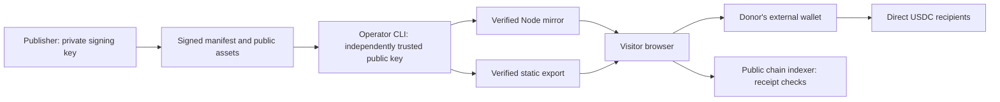

# Trust model and v1 protocol

## Scope

Evolve Hosting distributes **public static applications**. It is not private storage, a backend database, an identity service, a payment custodian, or a guarantee of availability. It supports ordinary HTTP mirrors and static hosts. Peer-to-peer transport, relay discovery and automatic rewards are not implemented in this version.

## Release format

The JSON envelope has exactly `schema`, `manifest`, `signature` and `assets`. Schema is `evolve-hosting.bundle.v1`. The manifest schema is `evolve-hosting.release.v1`; its fields are `project`, `version`, `sequence`, `createdAt`, `files`, `mirrors`, `support` and `backends`, plus `schema`. Unknown fields are rejected. Objects serialize with recursively sorted keys, arrays preserve order, primitive serialization uses JSON, and only safe-integer numbers are accepted. The signature is Ed25519 over UTF-8 bytes of this canonical manifest, with no prehash. Signature bytes use standard padded base64. A release ID is the hexadecimal SHA-256 of the same manifest bytes. Publisher fingerprints are SHA-256 of Ed25519 SPKI DER public keys.

Files declare `path`, byte `size` and lowercase SHA-256. Assets carry matching ordered `path` and base64 `data`. Implementations enforce file, total and encoded-input limits, allowed paths, exact asset ordering and unique paths including case-insensitive collisions. Every byte is decoded and hashed before activation or export. `.env`, hidden paths, traversal, symlink inputs, execution tooling and private-key PEM data are rejected. Arbitrary secrets disguised as allowed public data require publisher review; there is no promise of comprehensive secret detection.

Reference: [Node crypto](https://nodejs.org/docs/latest-v22.x/api/crypto.html), [Ed25519 RFC 8032](https://www.rfc-editor.org/rfc/rfc8032).

## Trust root and bootstrap

An operator obtains a public key through a separate trusted channel and supplies it explicitly to the CLI. Bundles contain no authority to choose or replace that key. Verification, export and serving accept only public SPKI PEM inputs; a private signing key is refused rather than being reflected by public inspection endpoints. An active store pins its project identity and key fingerprint. A different project's release, unexpected signer or non-increasing update sequence is refused. Explicit rollback changes to the retained previous release while retaining the highest sequence seen.

The browser verifies a bundle but cannot establish trust in the page that delivered its own code or key. An untrusted mirror can replace both. Use a trusted HTTPS bootstrap and an independently obtained key, or verify locally with a trusted CLI. A valid signature establishes publisher authorization, not that the app is benign, audited, or correct. Serve distinct publishers on distinct origins: same-origin apps can access one another's browser storage. The example's private checklist does not sync between mirror origins.

Key revocation/rotation is manual in v1. Distribute a replacement public key independently and provision a new mirror store after reviewing the migration. There is no transparency log, network-wide revocation service or automatic key rollover.

## Activation and serving

The operator controls its local store, keys, machine and reverse proxy. Local malicious administrators and concurrent modification by unrelated local programs are outside the trust boundary. Do not use a shared world-writable store. Bundle files are immutable by release ID; an exclusive update lock serializes cooperating writers. Verified state activates through a temporary file and rename. This is local-filesystem atomic replacement, not a multi-machine transaction or a promise of durability after arbitrary power loss. After a crash, inspect state and processes before removing a stale `update.lock`.

The Node server keeps verified assets in memory, reloads when the active pointer changes, and serves only listed assets and fixed public inspection endpoints. It never executes app files on the server or resolves a request to an arbitrary filesystem path. Writes are refused. Security headers disable MIME sniffing, framing and object embeds; the default CSP expects external same-origin scripts/styles and permits HTTPS connections. Some existing applications will need a reviewed host policy. Node listens on loopback unless explicitly configured; public use needs HTTPS termination and operator resource limits.

Static exports include a complete app and inspection panel, public metadata, signed bundle, trust key and Netlify-style headers. Other providers must reproduce the response headers and MIME types. Files on an HTTP mirror can still be changed by that operator after export; a remote metadata claim is not an attestation of every browser response.

## Discovery and recovery

Mirror URLs are signed into a release. There is no mandatory discovery service. URLs reject credentials, query strings and fragments. Plain HTTP is accepted only for explicit loopback URLs. Network diagnostics require an explicit user action, so opening the public workspace does not automatically contact listed mirrors or a payment indexer. Operator-specified mirror checks may reach networks accessible from that operator's machine; inspect the trusted mirror list before enabling checks. The Node serving endpoint does not fetch arbitrary URLs on behalf of visitors.

Metadata reads are bounded, time-limited and reject redirects. A matching response means that the endpoint **reports** the expected release; it does not establish a trustworthy operator or prove that its HTML is unmodified. Existing direct mirror links remain usable when checks fail.

If the first origin is down, browser JavaScript cannot repair a page that never loaded. A user needs a known alternate URL, a local copy, or a separately operated DNS recovery path. Private APIs and payment indexers are distinct dependencies. No local drill proves worldwide availability or a DNS recovery guarantee.

## Support and receipt verification

Fairground's payment rail is vendored with source hashes and its upstream commit. Dependency licenses remain included. The public app uses native USDC on Algorand and [ARC-26 wallet URIs](https://dev.algorand.co/arc-standards/arc-0026/). Donor wallet keys never enter this app or a mirror. Recipients and origin claims are publisher-reviewed and signed, not automatically validated against domain ownership. No untrusted discovery announcement can add recipients to a signed release.

Readiness checks require each selected address to have a non-frozen USDC holding. Failure returns no payment links; shares are not silently redirected to another recipient. The public chain indexer is trusted for these reads and confirmation evidence; this application is not a validating Algorand node. Its unavailability prevents confirmation but does not undo a payment already sent.

Each payment has a cryptographically random session nonce in its note, an exact micro-USDC amount and a one-hour confirmation window. Verification requires mainnet genesis hash, the native USDC asset ID, positive confirmed round, recipient, amount, note and receipt time matching that request. Reused IDs are rejected within the current confirmation session. This is local UI bookkeeping, not a global receipt ledger, a reward oracle or protection against a compromised indexer. Refreshing the page discards pending plan state; keep transaction IDs and consult the recipient before sending again after uncertain outcomes. Split donations are separate transactions and can partially complete. No automatic retry occurs.

## Test evidence

- `test/release.test.mjs`: independent key, signature/integrity failure, strict schema, path/size limits, symlinks, private-key data, refusal to overwrite.
- `test/store.test.mjs`: preserved active release, hot updates, rollback and replay barrier, concurrency, pinned project/key, restricted HTTP access, verified static export.
- `test/cli.test.mjs`: JSON, safe failure output, offline diagnostics and explicit network checks.
- `test/support.test.mjs`: no-custody wallet links, recipient readiness, correct chain/asset/amount/note/time, split payments and receipt reuse.
- `test/browser.mjs`: browser verifier, mobile layout, untrusted text, failed mirrors, opt-in donations, rejected/accepted receipt fixtures, local storage and inspection portal.
- `tools/drill.mjs`: independent CLI processes and stores, rejected corruption, one offline process and a surviving copy. Its report states exactly what was measured.
